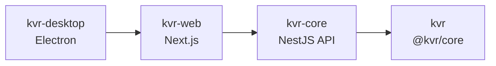

# Nx Project Graph

Use Nx to inspect how applications and libraries in this monorepo depend on each other.

## View the graph

```bash
pnpm graph
```

This starts the interactive Nx graph viewer. Bind it to a specific host and port when needed:

```bash
pnpm exec nx graph --host=0.0.0.0 --port=4211 --open=false
```

## Export

```bash
pnpm graph:json   # docs/architecture/project-graph.json
pnpm graph:html   # tmp/project-graph.html
pnpm nx:projects  # list detected projects
pnpm graph:verify # assert expected projects and edges
```

Open `docs/architecture/project-graph-view.html` for a static Mermaid view of the same graph.

## Projects



| Project | Path | Type | Depends on |
| --- | --- | --- | --- |
| `kvr` | `packages/kvr` | library | — |
| `kvr-core` | repository root | NestJS API | `kvr` |
| `kvr-web` | `apps/kvr-web` | Next.js dashboard | `kvr-core` |
| `kvr-desktop` | `apps/kvr-desktop` | Electron shell | `kvr-web` |

Allowed direction: applications → shared packages → KVR-Core. Core must not depend on applications.
